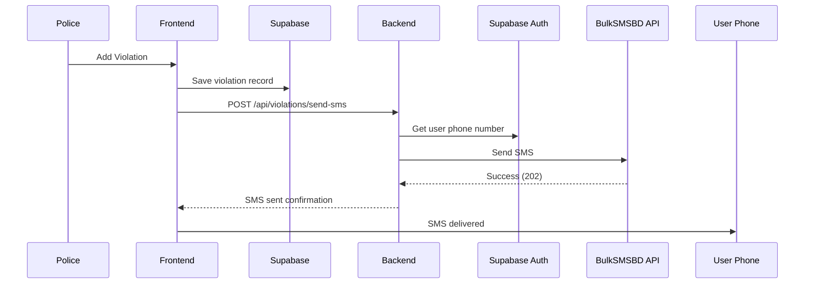

# SMS Notification System - Setup Guide

## 📱 Overview

When a police officer adds a traffic violation fine, the user automatically receives an SMS notification on their registered mobile number containing:
- Fine number
- Violation reason
- Fine amount
- Payment link to the website

## 🔧 Implementation Details

### API Provider: BulkSMSBD
- **API Key**: `key`
- **Sender ID**: `Random`
- **Endpoint**: `http://bulksmsbd.net/api/smsapi`
- **Success Code**: 202

### Phone Number Source
User's phone number is retrieved from **Supabase Authentication** (provided during signup), not from NID data.

## 📁 Files Created/Modified

### 1. **Backend SMS Service** (`backend/smsService.js`)
```javascript
// Core functions:
- sendSMS(phoneNumber, message)           // Generic SMS sender
- sendViolationSMS({...})                 // Violation-specific SMS
- getUserPhoneNumber(supabase, userId)    // Get phone from auth
```

**Features:**
- ✅ Phone number validation (01XXXXXXXXX format)
- ✅ URL encoding for special characters
- ✅ Automatic country code removal (+880 → 01)
- ✅ Error handling and logging

### 2. **Backend API Endpoint** (`backend/server.js`)
```javascript
POST /api/violations/send-sms
```

**Request Body:**
```json
{
  "userId": "uuid-here",
  "violationNumber": "VIO-2025-123456",
  "violationName": "Over Speeding",
  "amount": "2000.00",
  "websiteUrl": "https://brta.gov.bd"
}
```

**Response (Success):**
```json
{
  "success": true,
  "message": "SMS sent successfully",
  "phoneNumber": "017****5678"
}
```

### 3. **Frontend Integration** (`src/components/AddViolationModal.jsx`)
- SMS sent automatically after violation is created
- Non-blocking: Violation saves even if SMS fails
- Sends to backend endpoint with violation details

## 📲 SMS Message Format

```
BRTA Fine Alert!
Fine #VIO-2025-123456
Reason: Over Speeding
Amount: 2000.00 BDT
Pay now: https://brta.gov.bd
```

## 🚀 Setup Instructions

### Step 1: Backend Setup
The SMS service is already integrated. Just restart your backend:

```powershell
cd backend
node server.js
```

### Step 2: Verify Phone Numbers in Auth
Make sure users have phone numbers in Supabase Auth:

1. Go to **Supabase Dashboard** → **Authentication** → **Users**
2. For each user, ensure phone number is filled
3. Format: `01XXXXXXXXX` (without country code)
4. Or with country code: `+8801XXXXXXXXX` (auto-cleaned)

### Step 3: Test the System

#### Option A: Add Violation via Police Dashboard
1. Login as police officer
2. Scan vehicle QR code
3. Click "Add Violation"
4. Select violation type and location
5. Submit → SMS sent automatically

#### Option B: Test API Directly
```powershell
curl -X POST https://localhost:5000/api/violations/send-sms `
  -H "Content-Type: application/json" `
  -d '{
    "userId": "your-user-uuid",
    "violationNumber": "VIO-2025-TEST",
    "violationName": "Test Violation",
    "amount": "1000.00",
    "websiteUrl": "https://brta.gov.bd"
  }'
```

## 🔍 How It Works



### Flow Breakdown:

1. **Police adds violation** via `AddViolationModal.jsx`
2. **Violation saved** to `traffic_violations` table
3. **In-app notification** sent to user (existing)
4. **SMS API called** with user ID + violation details
5. **Phone number retrieved** from Supabase Auth
6. **SMS sent** via BulkSMSBD API
7. **User receives SMS** on registered mobile

## 📊 Error Handling

### SMS Failures Don't Block Violations
- If SMS fails, violation is **still saved**
- Error logged to console
- User still gets in-app notification

### Common Issues & Solutions

| Issue | Solution |
|-------|----------|
| "Invalid phone number format" | Ensure phone is 11 digits: `01XXXXXXXXX` |
| "User phone number not found" | User must have phone in Supabase Auth |
| "SMS sending failed" | Check API key, balance, or network |
| "Balance Insufficient" (1007) | Recharge BulkSMSBD account |

## 🔐 Security Notes

1. **API Key in Code**: Currently hardcoded in `smsService.js`
   - For production, move to `.env` file:
   ```env
   SMS_API_KEY=WUc2EjFMY7abkO72ojC5
   SMS_SENDER_ID=Random
   ```

2. **Phone Number Privacy**: Backend masks phone in logs (`017****5678`)

3. **Service Role Key**: Required to access Supabase Auth users
   - Already configured in `backend/.env`

## 📈 Monitoring

### Check SMS Logs
```powershell
# In backend terminal, you'll see:
✅ SMS sent successfully to: 01712345678
# Or
❌ SMS Error: Invalid phone number format
```

### Check BulkSMSBD Balance
```javascript
// API endpoint:
GET http://bulksmsbd.net/api/getBalanceApi?api_key=WUc2EjFMY7abkO72ojC5
```

## ✅ Testing Checklist

- [ ] Backend running on `https://localhost:5000`
- [ ] User has phone number in Supabase Auth
- [ ] Police can add violation successfully
- [ ] Console shows "✅ SMS sent successfully"
- [ ] User receives SMS within 1-2 minutes
- [ ] SMS contains violation number, reason, amount, link
- [ ] In-app notification also sent (existing feature)

## 🎯 Production Deployment

### Before Going Live:

1. **Move API credentials to environment variables**
   ```env
   # backend/.env
   SMS_API_KEY=WUc2EjFMY7abkO72ojC5
   SMS_SENDER_ID=Random
   ```

2. **Update smsService.js to use env vars**
   ```javascript
   const SMS_API_KEY = process.env.SMS_API_KEY;
   const SMS_SENDER_ID = process.env.SMS_SENDER_ID;
   ```

3. **Update website URL in production**
   - Currently uses `window.location.origin` (auto-detects)
   - For production, replace with your actual domain

4. **Monitor SMS balance** regularly to avoid service interruption

## 🆘 Troubleshooting

### SMS Not Sending?

1. **Check backend logs** for errors
2. **Verify user phone** in Supabase Auth
3. **Test API directly** using curl command above
4. **Check BulkSMSBD balance** (might be depleted)
5. **Verify API key** is correct

### User Not Receiving SMS?

1. **Phone number format** must be `01XXXXXXXXX`
2. **Network delay** - can take 1-2 minutes
3. **Spam filtering** - check user's spam folder
4. **Check response code** - 202 means success

## 📞 Support

- **BulkSMSBD Support**: [https://bulksmsbd.net/](https://bulksmsbd.net/)
- **API Documentation**: Check screenshots provided

---

## 🎉 System Complete!

The SMS notification system is now fully integrated with your BRTA violation system. When police add a fine, users get instant SMS alerts! 🚗💨📲
